<p align="center"></p>

# Augur

   

Calls the [PalDuels](https://palduels.com/live) fights (chat-run Palworld duels on a Kick stream) before the bell, and keeps score.

Augur lives in the menu bar (macOS) or the tray (Windows). The menu bar shows the favourite and its chance; on Windows the tray icon is a gold ring filled to the chance around a dot in the favourite's colour. Click it for the call: the pick, why, the stats, the bet to type (`!h`, `!h 2300` or `!h all`) and the chat line in five voices, each with a copy button. The main window has the rest: Live, History (Augur's calls, and your bets next to them; click one for how the duel went and how Augur called it), Pals, Players (anyone's pal box: each pal's tier, power and talent rolls), You (signed in: your profile, titles and your own pals, with rerolls), Model and Settings.

Built with [Tauri 2](https://tauri.app): a Rust engine and a small web page for the screens. About 9 MB.

## Install

Download the installer for your computer from the [latest release](https://github.com/TrongatesLegacy/augur/releases/latest), under **Assets**:

| Computer | File |
|---|---|
| **Windows** 10 or 11, 64-bit | `Augur_<version>_x64-setup.exe` |
| **Mac** (Apple silicon or Intel), macOS 11 or newer | `Augur_<version>_universal.dmg` |

Linux: run it from source (below); there's no installer yet.

The app is free, and it isn't signed with a paid Apple or Microsoft certificate, so your computer warns you the first time. That's expected:

**Windows**
1. Open the `.exe` you downloaded.
2. If a blue *Windows protected your PC* box appears, click **More info**, then **Run anyway**.
3. Follow the installer. It installs for you only, so it doesn't need an administrator. Augur opens when it's done and gets a Start menu shortcut.

**Mac**
1. Open the `.dmg` and drag **Augur** into **Applications**.
2. Open Augur from Applications. macOS says it can't check it for malware: click **Done**.
3. Open **System Settings › Privacy & Security**, scroll down to *"Augur" was blocked* and click **Open Anyway** (and again in the box that follows), then enter your password. You only do this once.
4. If macOS asks to use *Augur Safe Storage* in your keychain (the first time you sign in to PalDuels, or after an update), enter your password and click **Always Allow**. That key encrypts your saved sign-in.

**Then:**
1. The first time, Augur asks whether this is a new computer for an Augur you already use. **Import a backup** brings your calls, bets and every past duel across from your other computer (Settings › Sync & data › Back up… there). **Start fresh** fetches the duel history in the background.
2. Augur lives in the menu bar (Mac) or the tray (Windows). Click it for the call on the fight that's up, the bet to type and the chat line. The main window has the rest. It opens with Augur; to have only the tray icon at launch, turn on **Settings › General › Start in the tray**.
3. Optional: sign in to PalDuels in **Settings › Account** to track your bets against Augur's calls and reroll your pals from **You › Pals**. Augur reads your picks, balance and pal box; it never picks or chats for you, and spends credits only on a reroll you confirm.

Augur updates itself: when there's a new version, it downloads it and offers **Restart to update** (Settings › Updates). Nothing installs until you click it. Copies older than the first version with updates (0.1.1 and before) need the next one installed by hand once.

### Run from source

For Linux, or to work on the app. Needs [Rust](https://rustup.rs) (stable); on Linux also [Tauri's system packages](https://tauri.app/start/prerequisites/#linux).

```sh
cargo run -p augur                 # the app
cargo run -q -p augur -- predict   # the duel that's up now, from the command line
cargo run -q -p augur -- --help    # predict, backfill, import, export, analyse, tune, bets, status
```

### Building the installers yourself

```sh
cargo install tauri-cli --version "^2" --locked
cd app && cargo tauri build        # on a Mac -> target/release/bundle/dmg/Augur_<version>_<arch>.dmg
                                   # on Windows -> target/release/bundle/nsis/Augur_<version>_x64-setup.exe
```

## Layout

| Path | What it is |
|---|---|
| `engine/` | Everything that isn't the desktop app (`augur-engine`): fetching and parsing palduels.com (`site`), the model (`model`), the SQLite store (`db`), a whole prediction (`predict`), the background backfill (`backfill`), the chat voices (`voices`), the calls file (`calls`), what the history says (`history`), the stake to suggest (`stake`), your bets and how following Augur compares (`bets`), sync across computers (`sync`) and the test seed (`seed`). |
| `app/` | The desktop app and command line (`augur`): tray, windows, sync loop, encrypted sign-in (`secure.rs`), settings, what each page is sent (`views.rs`), headless UI tests (`ui_tests.rs`). |
| `ui/` | The pages, as ES modules with no build step: `index.html` + `main.js` (main window), `tray.html` + `tray.js` (popover), `lib/` (shared pieces), `tabs/` (one file per tab), `style.css`. |
| `fixtures/calls.jsonl` | 19 made-up calls (real species, invented fighters, owners and results) in the calls-file format, with the model's expected numbers. Test data only: your own calls stay in your data folder. |
| `engine/tests/pages/` | Saved palduels.com pages the tests parse, with placeholder players. The picks pages are made-up bets in the signed-in picks list's markup. |
| `assets/` | The logo and tray icon sources. `app/icons/` is generated from `assets/icon.png` (`cargo tauri icon`). |
| `scripts/` | The release scripts the build workflow runs. |

## Your data and the first launch

The app and the command line share one data folder: `~/Library/Application Support/Augur` on macOS, `%APPDATA%\Augur` on Windows (`AUGUR_DATA_DIR` overrides it). It holds `augur.db`, `settings.json`, `sync.json`, the pal art cache and the encrypted sign-in.

On first launch the store is empty, and a welcome over the whole window offers **Import a backup…** (from another computer: it brings the calls, bets and every past duel across) or **Start fresh**. The background fetch waits for that choice, at most 10 minutes. Live calls work straight away either way. Then, in the background, Augur fetches every species (a few minutes), then past duels with fight tapes, newest first, then the older results-only ones (about an hour in all). One page at a time, paused whenever a duel is up on stream. Each HTTP 429 slows it down, and 429s in a row wait longer each time: 2, 4, 8, 16, then 30 minutes at the slowest pace. After six in a row the run stops, and the next one, 6 hours later, carries on. Later runs fetch only what's new: duels since the last run, plus every species again once a week. And each launch first catches up on the duels fought while Augur was closed (up to 100, newest first, one page every 2 seconds), without waiting for a break in the stream. The sidebar shows a ring while any of this runs ("Catch-up", "Fetching", "Bets" while your bets come in), "Site busy" while it waits, and "Synced" for a few seconds when calls or settings arrive from another computer; hover it for everything going on. Duel numbers the site says don't exist aren't asked for again. To bring your own calls across: `augur import calls.jsonl` (and `augur export` to back them up).

## Updates

Augur updates itself from this repository's GitHub releases:
- **Checking:** shortly after it starts, then every 6 hours. It downloads a new version in the background.
- **Installing:** a notification, a bar over the main window, a strip in the tray popover and **Settings › Updates** each offer **Restart to update**. Nothing installs until you click it, so a duel is never cut off. Restarting takes a few seconds, and the main window comes back if it was open.
- **After restarting:** Settings › Updates says what changed.
- **Signed:** updates are signed with the project's update key, and Augur refuses one with a bad signature.
- **Switches:** both automatic checking and automatic downloading can be turned off in Settings › Updates.

## More than one computer

**Settings › Sync & data › Sync** works the way Stream Multiview's does:
- **The folder:** you pick a folder a sync app already moves. Augur finds OneDrive, iCloud Drive, Dropbox and Google Drive, or you can choose another folder. It creates `Augur Sync/` inside it.
- **No clashes:** each computer writes only its own files there (`devices/<id>.json` and `calls/<id>.jsonl`) and reads the others' every minute, and within seconds of the sync app bringing a change in. Nothing needs a lock, and the sync app never makes "conflicted copies".
- **What syncs:** your settings (the latest change to each one wins) and Augur's calls (merged, never duplicated).
- **What stays on each computer:** the sign-in (it's encrypted for that computer), launch at login, start in the tray and background fetching. Duels, species and your bets come from the site on each computer.

**Back up… and Import…** cover setting up a new computer:
- **Back up…** saves a complete copy of the store (calls, duels, tapes, species, bets) wherever you choose, such as OneDrive.
- **Import…** merges one in, or a calls file. It adds what's missing and never overwrites, so a new PC skips the hour-long first fetch.

Don't move the data folder itself into OneDrive: the app writes to its database every few seconds, and syncing a live SQLite file can corrupt it.

The main window lays out for 1280×720 and zooms to fit any other size, so it looks the same on a laptop and on a big monitor.

## The data

| Table | One row per |
|---|---|
| `predictions` | Call: chance, each factor's share, species records and pal head-to-head as they stood, model settings used, status (`open`, `settled`, `skipped`). |
| `fighters` | Side of a call: final Lv 70 stats (with passives), IVs, types, passives, hidden-move boost, cooldown speed, and the site's pal rank (tier, rank, power) when called. |
| `duels` | Finished duel: owners, pals, winner, K.O. time, winner's HP left, cast counts. |
| `hits` | Hit on a duel's tape: side, time, move, damage as % of the target's HP. |
| `species` | Species: types, the ladder's power rating, base HP, Attack and Defence. |
| `species_moves` | Species' listed move: element, power, unlock level. |
| `bets` | Your bet, from your picks list (signed in): its place in your history, the duel (recent ones), the side backed, stake and result. |
| `meta` | Small state: backfill progress, the signed-in account's name, your last balance, when the picks list was read. |

## Rerolling your pals

**You › Pals** shows your own box (signed in) with what one IV reroll would do for each pal. Duels are matched by power (over 1,346 duels the two sides' power correlated 0.85), so a pal meets the same pals whatever its rolls: Augur takes the ones its species has met in its last 80 past duels (or species within 10 power, when there are fewer than 10) at an average roll, and works out the pal's win chance against them with its rolls now and with every new roll (each IV from 5 to 95 in steps of 10). A reroll keeps the better of the new three and the old, so it can only help; the price, read from the site for each pal and doubling with each reroll, decides whether it's worth it: **Reroll** at 2 or more win-chance points per 1,000 credits, **Maybe** at 0.75, else **Keep** (or **Replace**, under 42%).

Pick a pal and the panel shows its rolls, its win chance now and after a reroll, and the spread of every new roll's win chance. **Roll** takes a second click to spend; it sends the site's own form with the price you saw as its limit, so the site won't charge more. Then the old and new rolls sit side by side with their win chances, the site's verdict and Augur's pick, and you keep one with the site's own buttons (within 15 minutes, or the old IVs stay). While the site works ("Rolling your IVs…", "Saving your choice…") Augur asks again as its own page does, then reads your box again for the new rolls and the doubled price.

## How the model works

1. **Stats:** time to knock the other side out = its HP ÷ (my Attack ÷ its Defence × my move strength). Move strength averages every usable move, with power counting only a little (`power ^ 0.35`), times the type multiplier (1.5× into a type it beats, ÷1.5 into one that resists it; dual types multiply). The ratio of the two times becomes a win chance.
2. **Adjustments to move strength:** damage from moves the site doesn't list (species-only attacks like Bushi Noct's Iai, found in the pal's last 3 fight tapes), and cooldown passives. Both are damped until proven.
3. **Records:** the species' win/loss records and past fights between the two species shift that chance on the log-odds scale, each pulled toward 50% so small samples barely move it.
4. **Pal rank:** the site's own rank for each pal ("Tier C, ranked 154 of 357, power 55/100"), which moves as a species wins or loses against its rank. Live and History show it (the tier with each side's tags, a row in the tale of the tape). It starts with no weight: over 1,346 past duels it added nothing to the stats and records, so it learns only from real calls that read it, once there are 60.

When the site hides a fighter's stats until the bell ("stats known at the bell"), Augur takes them from its owner's pal box: the card shows the stats, talent rolls and passives it fights with. Only when the owner has none or several of that pal does it estimate them from base stats at an average roll, and the call says so. The crowd's picks are never used.

**It tunes itself.** Straight after each result, and whenever the backfill brings in 25 more past duels, Augur re-fits every setting: types, move power and the records on every past duel, the stat settings and cooldown passives on real calls (they're the only ones with each pal's actual stats; they wait for 60), and how much the species records count on real calls, which learns from every call: it moves from the past duels' species weight toward what the calls fit best, calls / (calls + 60) of the way. Records get their own weight on real calls because the past duels only have base stats, where records say more; on the first 50 real calls, going by stats alone was right 76% of the time and the records only 57%. The newest quarter of each is held back, and a change is kept only if it predicts those better. The Model tab shows each setting, what it learned from and what it changed. Settings > Model turns this off to use your own values; it keeps learning meanwhile. Owners aren't in the model: an owner's record predicted no better than a coin flip over 4,702 duels, and added nothing to the species records. The pal rank is, at no weight until real calls show it helps.

## Bets

Augur never bets for you: it suggests a stake and the chat command, and you type it. Settings > Staking picks how:

- **Scale with chance** (the default): the default bet (a bare `!h`) below 55%, rising steadily to the max (`!h all`) at 85% and above. Both chances are settings.
- **Fixed amount** on every call.
- **Default or max:** the max (`!h all`) from a chance you choose (70% to start), the default bet (a bare `!h`) below it.

The limits (100 to 5,000, 500 for a bare command) are settings because the site doesn't publish them. "Type the max as all" keeps `!h all` right if the stream changes the max.

Signed in, Augur reads your picks list (only shown to you, 5 bets a page): all of it once, a page at a time and paused while a duel is up, then just what's new every few minutes. History > Your bets lines your bets up with Augur's calls: **Followed** (you backed Augur's pick, at any stake), **Deviated** (the other side, or a bet when Augur said sit out), **Missed** (no bet on a call Augur would have bet on: kept out of the comparison and totalled on their own) and **No call**. "Augur's way" uses the stake Augur suggested at the time: on the side you backed it's your real payout scaled to that stake; a win on the other side is an estimate at your usual payout.

## Tests

```sh
cargo test --workspace
```

Every test runs from the seed in the repo (`fixtures/calls.jsonl` and `engine/tests/pages/`, loaded by `augur_engine::seed`): no network, no local data. The saved pages use placeholders (`player-NN`) instead of real player names. The UI tests serve the real pages from a small local web server and render them in **headless Chrome**, with a stand-in for the Tauri bridge serving what the app's commands return. Nothing appears on screen and your Chrome profile isn't touched. They skip without Chrome locally (set `CHROME` to point at it) and fail without it in CI. `AUGUR_UI_SHOTS=<folder> cargo test -p augur every_tab` also saves a 1280×720 screenshot of every tab.

## Contributing and releases

**Making a change:** open a pull request against `main`. Don't change the version or `CHANGELOG.md` in it. Write the title as one line a user would understand, because titles become the release's "What's new". Every pull request runs the tests (macOS, Windows, and the engine on Linux) and builds both installers as a test (under the run's **Artifacts**). The installer build also runs after each merge to `main`, which keeps its caches warm for every pull request and release.

**Making a release:** publish a GitHub release with a new tag like `v0.1.1` from the latest `main`, and click **Generate release notes**. The build workflow:
1. sets the version from the tag, adds the notes to `CHANGELOG.md`, commits that to `main` and moves the tag onto it;
2. builds the installers with Tauri's own action ([`tauri-apps/tauri-action`](https://github.com/tauri-apps/tauri-action)) and attaches them:
   - **Mac:** `Augur_<version>_universal.dmg` (Apple silicon and Intel).
   - **Windows:** `Augur_<version>_x64-setup.exe` (installs for the current user, no admin needed).
   - **For installed copies to update from:** the signed update files (`Augur.app.tar.gz` and the setup `.exe`, each with a `.sig`) and `latest.json`, which the app reads from the latest release.

**Secrets the release uses:**

| Secret | What it's for |
|---|---|
| `MAC_CERT_P12`, `MAC_CERT_PASSWORD` | Augur's own self-signed certificate ("Augur Code Signing"), base64 of the .p12 and its password. Every version is signed with it, so macOS recognises updates as the same app and keeps letting Augur read its Keychain item (the saved sign-in). Without it the app is signed ad hoc and the saved sign-in won't survive updates. |
| `TAURI_SIGNING_PRIVATE_KEY`, `TAURI_SIGNING_PRIVATE_KEY_PASSWORD` | The update key (from `cargo tauri signer generate`) and its password. Every update is signed with it, and installed copies check the signature against the public key in `app/tauri.conf.json`. Keep a copy somewhere safe: without it, no future update can reach installed copies. |
| `RELEASE_DEPLOY_KEY` | Optional: a deploy key with write access, for pushing the version commit if `main` is protected by a ruleset that lists the key under Bypass. Without it the release pushes with the workflow's own token. |

The certificate isn't Apple's, so the first time someone opens a new install, macOS asks them to allow it in **System Settings → Privacy & Security → Open Anyway**. Windows SmartScreen may say "Windows protected your PC": **More info → Run anyway**.
